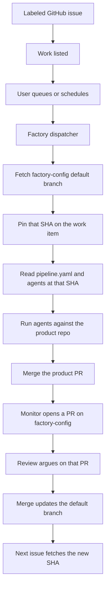

# Factory

Self-hosted software factory. Issues in, agents out, learning after merge.

The **Factory** image is the engine. **[factory-config](https://github.com/akoskm/factory-config)** is the program it runs (`pipeline.yaml` + `agents/*/agent.md`). Product work happens in your product repos. Secrets stay in Factory Settings.



Labeling an issue only lists it under **Work** (status `listed`). **Queue** puts it on the factory backlog (chevron: start now if a slot is free, or schedule for later); the dispatcher starts work up to `maxConcurrentRuns`. A work item keeps the config SHA it started with until it finishes. A learn PR changes the next run only after it merges.

Set the config repo URL in **Settings → Factory config** (or `FACTORY_CONFIG_REPO` env). Default dogfood repo: https://github.com/akoskm/factory-config

## Run

```bash
cp .env.example .env
docker compose up --build
```

Open http://localhost:3000 (password from `ADMIN_PASSWORD`).

Harnesses: `cursor`, `claude-code`, `local`, `opencode` (set per agent in factory-config `agent.md`). The Docker image installs the Claude and OpenCode CLIs.

## Local dev

```bash
docker compose up postgres temporal temporal-ui -d
npm install
npm run db:migrate
npm run dev
```

Local OpenCode runs need the `opencode` CLI on `PATH` (`curl -fsSL https://opencode.ai/install | bash`).

UI with HMR: http://localhost:5173 (proxies `/api` to `:3000`).

## Behavior proof (verify)

When the pipeline hits **verify**, Factory plans a scenario, ensures a product-repo GitHub Actions workflow (default `factory-proof.yml`) exists on the default branch (bootstraps a setup PR if missing), dispatches it, stores uploaded recordings, comments on the feature PR, and Inbox-holds when there is something to look at.

See [`templates/proof/`](templates/proof/) for the workflow contract and a sample verify agent frontmatter for factory-config. Set `FACTORY_PUBLIC_URL` so CI can reach Factory’s upload endpoint.

## Dogfood

1. Create a project pointed at this repo
2. Add a GitHub source with label `factory`
3. In Settings, confirm Factory config points at `https://github.com/akoskm/factory-config`
4. Set harness API keys in Settings (Cursor required for dogfood; OpenCode / Anthropic / Local as needed). Env vars like `CURSOR_API_KEY` / `OPENCODE_API_KEY` are instance-wide fallbacks for all projects — prefer per-project secrets in multi-project installs. Docker image includes `claude` and `opencode` CLIs; set `harness: opencode` in an agent.md to use OpenCode.
5. Label an issue `factory` — it appears under **Work** as listed (not auto-started)
6. On the row: **Queue** (chevron: Queue and start, Schedule…)
