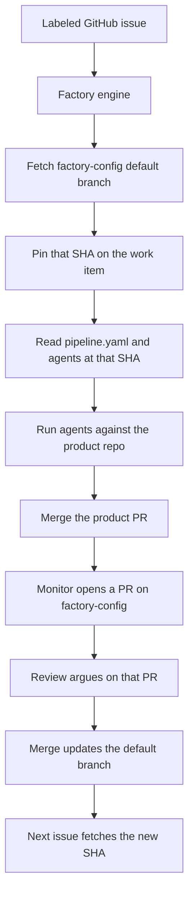

# Factory

Self-hosted software factory. Issues in, agents out, learning after merge.

The **Factory** image is the engine. **[factory-config](https://github.com/akoskm/factory-config)** is the program it runs (`pipeline.yaml` + `agents/*/agent.md`). Product work happens in your product repos. Secrets stay in Factory Settings.



A work item keeps the config SHA it started with until it finishes. A learn PR changes the next run only after it merges.

Set the config repo URL in **Settings → Factory config** (or `FACTORY_CONFIG_REPO` env). Default dogfood repo: https://github.com/akoskm/factory-config

## Run

```bash
cp .env.example .env
docker compose up --build
```

Open http://localhost:3000 (password from `ADMIN_PASSWORD`).

## Local dev

```bash
docker compose up postgres temporal temporal-ui -d
npm install
npm run db:migrate
npm run dev
```

UI with HMR: http://localhost:5173 (proxies `/api` to `:3000`).

## Dogfood

1. Create a project pointed at this repo
2. Add a GitHub source with label `factory`
3. In Settings, confirm Factory config points at `https://github.com/akoskm/factory-config`
4. Set Cursor API key
5. Label an issue `factory`
